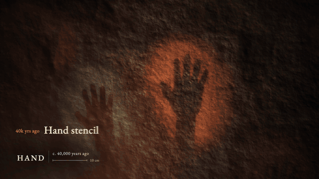
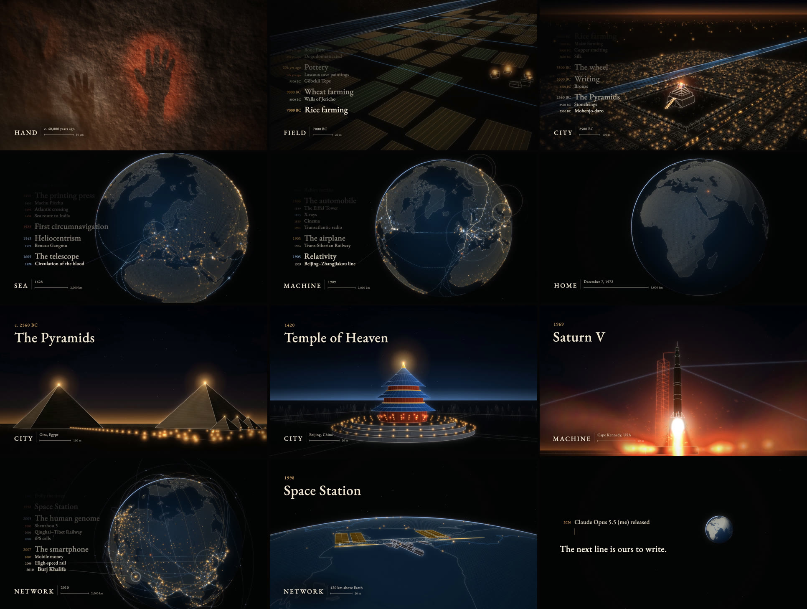

<p align="center"><b>English</b> ｜ <a href="README.zh-TW.md">繁體中文</a> ｜ <a href="README.zh-CN.md">简体中文</a></p>

# Civilization · 人類大歷史

**A 149-second film about human civilization. Every frame is drawn by code, and every note of the score is written by code.**

It opens on a 40,000-year-old hand stencil on a cave wall. A single camera keeps pulling back until the whole Earth is in view. Along the way, 176 human inventions, buildings and discoveries land on the beat, each one at the place where it actually happened.

<p align="center"></p>
<p align="center"><sub>The first 99 seconds at 11× speed. From the hand to the Earth it is one continuous shot, with no cuts.</sub></p>

## Watch

| | |
|---|---|
| **Play it in your browser** | [Live player](https://ddchen666.github.io/civilization-film/player.html?lang=en). Every frame is drawn in real time by the code. You can scrub the timeline and switch between three languages |
| **Bilibili** | [BV1Fsa66cENq](https://www.bilibili.com/video/BV1Fsa66cENq/) |
| **X** | [@chen79639ddc](https://x.com/chen79639ddc/status/2105657578793672722) |
| **Download 1080p** | [Releases](https://github.com/DDChen666/civilization-film/releases): English, Traditional Chinese and Simplified Chinese versions |

Project page, with a language switch: <https://ddchen666.github.io/civilization-film/>

## How it was made

- **Who did what.** **Claude Opus 5.5**, working in **Claude Code**, made all of the visuals, the music, the on-screen text and the milestone list. The director, **欸不是**, set the direction and reviewed the film at each checkpoint. It took about four and a half hours from the first message to all three language versions being rendered.
- **No assets at all.** The film uses no images, video, 3D models, sound samples or stock music. The map data is public-domain Natural Earth, and the fonts are open-source Noto Serif and EB Garamond.
- **Sound and picture share one timeline.** `score.py` writes the score first. At the same time it writes out the time of every drum hit and every theme note to `data/audio.json`. The visuals read only that file, so there is not a single hand-typed second anywhere in the code.
- **Reproducible.** The score is bit-identical on every synthesis. The picture is a pure function of time, and a fresh render of the full film is visually indistinguishable from the release. See [Reproduce it](#reproduce-it) for how this was checked.
- **Fast to render.** Canvas-only frames go straight to the Mac's hardware encoder, so the full film renders in about 1 minute 41 seconds at 1080p. For how it got there from 15 minutes, see [Fast rendering](docs/fast-render.en.md).

| Document | What's inside |
|---|---|
| [Making of](docs/making-of.en.md) | What the director said at each step, how Claude decided, which decisions were overturned, and before/after comparisons |
| [How it works](docs/how-it-works.en.md) | How one camera covers 7.5 orders of magnitude, how milestones lock to the beat, and how the score is built up layer by layer |
| [The 176 milestones](docs/fact-check.en.md) | Year, place and names in three languages for every milestone, plus its fact-check status |
| [Fast rendering: from 15 minutes to 1:41](docs/fast-render.en.md) | Measure first: the screenshot bottleneck, hardware encoding, a drawing trap hidden in dashed lines, and a measured comparison with HyperFrames |

## Stills



## By the numbers

| | |
|---|---|
| Length | 2 min 29 s, 140 BPM, C minor |
| Milestones | 176, roughly grouped by location: East and South Asia about 54, Europe about 61, Middle East and Africa about 20, the Americas and the Pacific about 41 |
| Wonders | 15 line-drawn 3D scenes, with every named building modeled at real scale: the hand stencil, Stonehenge, the Pyramids, Babylon, the Parthenon, the Great Wall, the Colosseum, Angkor Wat, the Temple of Heaven, the Taj Mahal, the Eiffel Tower, the moon rocket, the International Space Station, a city and a chip |
| Camera distance | From 0.74 m to 26,000 km, in one continuous move |
| Code | About 3,800 lines of JavaScript and Python, with no frameworks |
| Audio-visual sync (measured) | 95% of cuts land on a beat, against 16% if they were placed at random. Of the 10 strongest accents, 9 get a visual response. On average, the picture trails the beat by just 4.7 ms |
| Loudness | −14 LUFS, true peak −2.5 dBTP |

## Reproduce it

You need Node.js 18+, Python 3.10+, ffmpeg and Google Chrome.

```bash
git clone https://github.com/DDChen666/civilization-film.git
cd civilization-film
npm install                      # one package: playwright-core (drives your installed Chrome)
pip install -r requirements.txt  # numpy, scipy
python3 score.py                 # synthesize the score → audio/score.wav, data/audio.json (~20 s)
npm run preview                  # try 10 seconds first → out/preview_en.mp4 (~1 min)
npm run render:en                # the full film in English → out/civilization_en.mp4
```

- `npm run render:tc` renders Traditional Chinese, `npm run render:sc` renders Simplified Chinese, and `npm run render:4k` renders 4K60. The full film takes about 2 minutes at 1080p on an Apple M3; 4K60 is estimated at 20–30 minutes.
- To watch without rendering, run `python3 -m http.server` and open <http://localhost:8000/player.html>.
- To measure your render, run `npm run check -- out/civilization_en.mp4`. It writes a contact sheet and prints loudness, rhythm and audio-visual sync figures.

**Verified** (2026-10-04, current code). The steps above were run from an empty folder. The regenerated score has the same SHA-1 as the released one. The full film was rendered in all three languages, 4,470 frames each with none missing, in 101 s (Traditional Chinese), 123 s (Simplified Chinese) and 116 s (English). Compared frame by frame with the released videos, the average PSNR is 44 dB in every case; the differences come from video compression and are invisible side by side.

## Project layout

```
stage.html          The composition page: given any time t, it draws the same frame (window.__seek)
player.html         The browser player: drives stage.html from the score's playback time
index.html          Project page (three languages)
render.mjs          Video renderer: parallel Chrome drawing, sub-frame motion blur, Mac hardware encoding (screenshots when the page has HTML elements)
score.py            The score: every instrument, every section, every layer
scorekit.py         Synth and mixer: oscillators, filters, loudness normalization, and the timeline output
src/
  film.js           The timeline: camera path, sections, milestone scheduling, the closing montage
  engine.js         3D math, camera, Earth occlusion, lines, solid faces, glow layers
  milestones.js     The 176 milestones (year, location, three languages)
  i18n.js           Fixed on-screen text in three languages, and fonts
  scene_cave.js     Cave wall and hand stencils   scene_land.js     Camp, fields, village
  scene_city.js     Babylon                       scene_globe.js    Earth, coastlines, city lights, routes
  scene_wonders.js  Pyramids, Temple of Heaven, Taj Mahal, moon rocket, city
  scene_wonders2.js Stonehenge, Parthenon, Great Wall, Colosseum, Angkor, Eiffel Tower, ISS, chip
lib/                Beat utilities (music.js), easing (motion.js)
data/               Geography (Natural Earth), the score's timeline
fonts/              Noto Serif TC / SC, EB Garamond (SIL OFL)
tools/              Measurement: sync.py (A/V sync), rhythm.py (pacing), check.sh (final check), sections.py (loudness per section)
docs/               Making of, how it works, fact-check, images
```

The code comments are in Traditional Chinese. [How it works](docs/how-it-works.en.md) explains the whole architecture in English.

## Known limitations

- Before release, 54 milestones and the dimensions of the wonders, about 60 facts in all, were checked online, and 7 were corrected as a result. The other 122 milestones are mostly well-known modern dates that were not checked one by one. See the [fact-check table](docs/fact-check.en.md) for the full status.
- The camp, the village, Babylon's streets, the modern city and the chip are illustrative. So are the paths of the trade routes, sea lanes, railways and cables.
- The film is meant as a hymn, so wars and disasters are left out.
- The people and tents in the "Fire" section are still rough. In the 12-second full-history replay, the text moves too fast to read on purpose, and paused frames show ghosting.
- The score was synthesized in code by Claude, which cannot hear audio. Every judgment about the sound was made from spectrograms and loudness measurements.
- Only a 1080p30 version exists for now.

## License

- **Code**: [MIT](LICENSE)
- **Film, score and the images in the docs**: [CC BY 4.0](LICENSE-MEDIA.md). You may share, remix and use them commercially, as long as you give credit.
- **Fonts**: SIL Open Font License 1.1. **Map data**: Natural Earth, public domain. See [CREDITS.md](CREDITS.md).

## Credits

- **Director**: 欸不是 ([Bilibili](https://space.bilibili.com/353565208) · [X](https://x.com/chen79639ddc) · [GitHub](https://github.com/DDChen666))
- **Code, visuals, music and text**: Claude Opus 5.5 (Anthropic), made in Claude Code

To cite:

> *Civilization* (人類大歷史). Directed by 欸不是, made by Claude Opus 5.5, 2026. https://github.com/DDChen666/civilization-film
