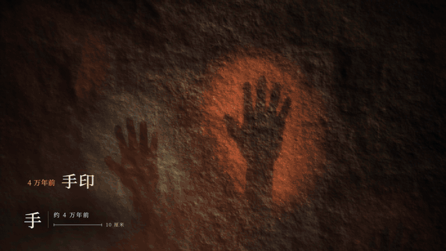
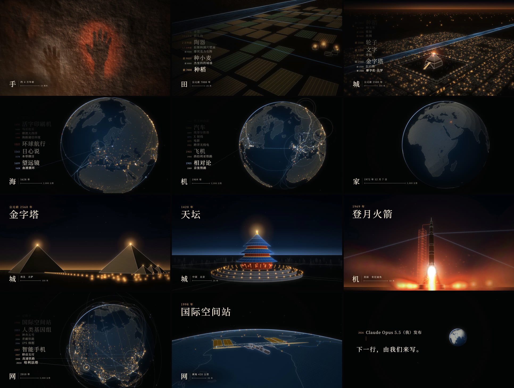

<p align="center"><a href="README.md">English</a> ｜ <a href="README.zh-TW.md">繁體中文</a> ｜ <b>简体中文</b></p>

# 人类大历史 · Civilization

**一部 149 秒的人类文明短片。画面全部用代码绘制，配乐全部用代码编写。**

从四万年前岩壁上的一个手印开始，一个镜头一路往后退，直到看见整颗地球。人类 176 项发明、建设与发现跟着节拍出现，每一项都落在它真正发生的地点。

<p align="center"></p>
<p align="center"><sub>前 99 秒以 11 倍速播放。从手印到地球是同一个镜头，中间没有剪辑。</sub></p>

## 观看

| | |
|---|---|
| **在浏览器里播放** | [网页播放器](https://ddchen666.github.io/civilization-film/player.html?lang=sc)：每一帧都由代码实时绘制，可以拖动进度、切换三种语言 |
| **Bilibili** | [BV1Fsa66cENq](https://www.bilibili.com/video/BV1Fsa66cENq/) |
| **X** | [@chen79639ddc](https://x.com/chen79639ddc/status/2105657578793672722) |
| **下载 1080p 视频** | [Releases](https://github.com/DDChen666/civilization-film/releases)：简体中文、繁體中文、English 三个版本 |

项目主页（可切换语言）：<https://ddchen666.github.io/civilization-film/>

## 这部片是怎么做出来的

- **制作分工**：画面、配乐、字幕和里程碑清单，全部由 **Claude Opus 5.5** 在 **Claude Code** 里完成。导演**欸不是**负责提出方向，并在每个关口看片、给反馈。从第一条消息到三个语言版本输出完成，大约四个半小时。
- **没有使用任何素材**：没有图片、视频、3D 模型、音效采样，也没有现成的音乐。地图来自公有领域的 Natural Earth 数据，字体使用开源的思源宋体和 EB Garamond。
- **声音和画面共用一份时间表**：先由 `score.py` 写好配乐，同时输出每个鼓点、每个主题音的时间（`data/audio.json`）。画面只读这份时间表，代码里没有任何手写的秒数。
- **可以复现**：配乐每次合成都逐位相同；画面是时间的纯函数，重新输出的整部片与发行版肉眼无差异。验证方法见[从零复现](#从零复现)。
- **输出很快**：纯画布的画面直接交给 Mac 的硬件编码器，整部片 1080p 约 1 分 41 秒。怎么从 15 分钟缩短到这里，见[快速输出](docs/fast-render.zh-CN.md)。

| 文档 | 内容 |
|---|---|
| [制作过程](docs/making-of.zh-CN.md) | 导演每次说了什么、Claude 怎么判断、哪些决定被推翻、每一关的前后对照 |
| [技术说明](docs/how-it-works.zh-CN.md) | 一个镜头怎么跨越 7.5 个数量级、里程碑怎么对上节拍、配乐怎么一层层叠上去 |
| [176 个里程碑与核实](docs/fact-check.zh-CN.md) | 每一项的年份、地点、三种语言的名称，以及核实状态 |
| [快速输出：从 15 分钟到 1 分 41 秒](docs/fast-render.zh-CN.md) | 先测再改：截图瓶颈、硬件编码、藏在虚线里的绘图陷阱，以及和 HyperFrames 的实测比较 |

## 画面



## 几个数字

| | |
|---|---|
| 长度 | 2 分 29 秒，140 BPM，C 小调 |
| 里程碑 | 176 项，按地点粗分：东亚与南亚约 54、欧洲约 61、中东与非洲约 20、美洲与太平洋约 41 |
| 奇观场景 | 15 个三维线稿场景，有名的建筑都按真实尺寸建模：手印、巨石阵、金字塔、巴比伦、帕特农神庙、长城、罗马斗兽场、吴哥窟、天坛、泰姬陵、埃菲尔铁塔、登月火箭、国际空间站、城市、芯片 |
| 镜头距离 | 从 0.74 米到 26,000 公里，一个镜头连续推过去 |
| 代码 | 约 3,800 行 JavaScript 和 Python，不用任何框架 |
| 音画同步（实测） | 切镜有 95% 落在节拍上，随机摆放只会有 16%；最强的 10 个重音里，9 个有画面回应；画面比节拍平均只晚 4.7 毫秒 |
| 响度 | −14 LUFS，真峰值 −2.5 dBTP |

## 从零复现

需要：Node.js 18 以上、Python 3.10 以上、ffmpeg、Google Chrome。

```bash
git clone https://github.com/DDChen666/civilization-film.git
cd civilization-film
npm install                      # 只有一个包：playwright-core（调用电脑上的 Chrome 截图）
pip install -r requirements.txt  # numpy、scipy
python3 score.py                 # 合成配乐 → audio/score.wav、data/audio.json（约 20 秒）
npm run preview                  # 先试做 10 秒 → out/preview_en.mp4（约 1 分钟）
npm run render:sc                # 整片简体版 → out/civilization_zh-CN.mp4
```

- 繁体版是 `npm run render:tc`，英文版是 `npm run render:en`，4K60 是 `npm run render:4k`。整片 1080p 在 Apple M3 上约 2 分钟，4K60 估计 20–30 分钟。
- 只想看、不想输出：运行 `python3 -m http.server`，然后打开 <http://localhost:8000/player.html>。
- 输出完可以自己测：`npm run check -- out/civilization_zh-CN.mp4` 会生成总览图，并打印响度、节奏和音画同步的数字。

**验证过**（2026-10-04，目前的代码）：在一个空文件夹按上面的步骤从头做了一次。重新合成的配乐，SHA-1 与发行版完全相同。三个语言的整部片各输出 4470 帧，一帧不差，分别花了 101 秒（繁体）、123 秒（简体）、116 秒（英文）；与发行版逐帧比对，平均 PSNR 都是 44 dB，差异来自视频压缩，并排看不出来。

## 项目结构

```
stage.html          合成页：给它任何时间 t，都画出同一帧（window.__seek）
player.html         网页播放器：用配乐的播放时间驱动 stage.html
index.html          项目主页（三种语言）
render.mjs          输出视频：多个 Chrome 并行绘制、子帧平均做动态模糊、交给 Mac 的硬件编码器（画面有网页元素时改用截图）
score.py            配乐：每个乐器、每个段落、每一层
scorekit.py         合成器与混音：振荡器、滤波、响度标准化，并输出时间表
src/
  film.js           时间轴：镜头路径、段落、里程碑排程、终段剪辑
  engine.js         三维数学、镜头、地球遮挡、线、实心面、光晕图层
  milestones.js     176 个里程碑（年份、地点、三种语言）
  i18n.js           画面上固定文字的三语对照、字体
  scene_cave.js     岩壁与手印          scene_land.js     营地、田、村子
  scene_city.js     巴比伦              scene_globe.js    地球、海岸线、城市灯火、航线
  scene_wonders.js  金字塔、天坛、泰姬陵、登月火箭、城市
  scene_wonders2.js 巨石阵、帕特农、长城、斗兽场、吴哥、埃菲尔、空间站、芯片
lib/                节拍工具（music.js）、缓动函数（motion.js）
data/               地理数据（Natural Earth）、配乐时间表
fonts/              思源宋体 TC／SC、EB Garamond（SIL OFL）
tools/              测量：sync.py（音画同步）、rhythm.py（节奏）、check.sh（成片检查）、sections.py（各段响度）
docs/               制作过程、技术说明、核实表、图
```

代码注释是繁体中文。英文读者可以先看 [How it works](docs/how-it-works.en.md)，里面有完整的架构说明。

## 已知的限制

- 公开前上网核实了 54 个里程碑和奇观的尺寸，共约 60 条，其中 7 处因此修正。其余 122 个里程碑大多是广为人知的近代年份，没有逐一核实。完整状态见[核实表](docs/fact-check.zh-CN.md)。
- 营地、村子、巴比伦的街道、现代的城市、芯片都是示意。商路、航线、铁路和电缆的走向也是示意。
- 这是一首赞歌，所以战争与灾难一律没有收录。
- “火”那一段的人物和帐篷仍然粗糙。“全史重播”那 12 秒的字故意快到看不清，暂停会看到残影。
- 配乐是 Claude 用代码合成的，制作过程中 Claude 无法听到声音，只能靠频谱和响度测量来判断。
- 目前只有 1080p30 的版本。

## 许可

- **代码**：[MIT](LICENSE)
- **视频、配乐、文档中的图**：[CC BY 4.0](LICENSE-MEDIA.md)。可以转载、剪辑、商用，但请注明出处。
- **字体**：SIL Open Font License 1.1。**地图数据**：Natural Earth，公有领域。详见 [CREDITS.md](CREDITS.md)。

## 署名

- **导演**：欸不是（[Bilibili](https://space.bilibili.com/353565208)・[X](https://x.com/chen79639ddc)・[GitHub](https://github.com/DDChen666)）
- **代码、画面、配乐、文字**：Claude Opus 5.5（Anthropic），在 Claude Code 中制作

引用时可以这样写：

> 《人类大历史》（Civilization），导演：欸不是，制作：Claude Opus 5.5，2026。https://github.com/DDChen666/civilization-film
