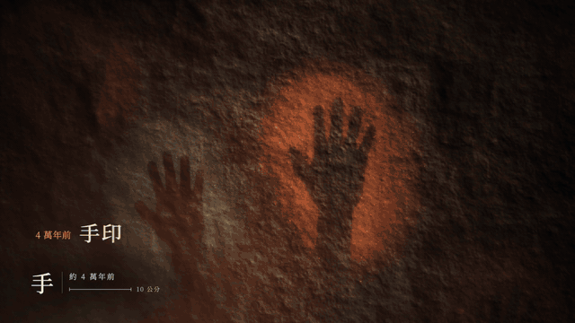
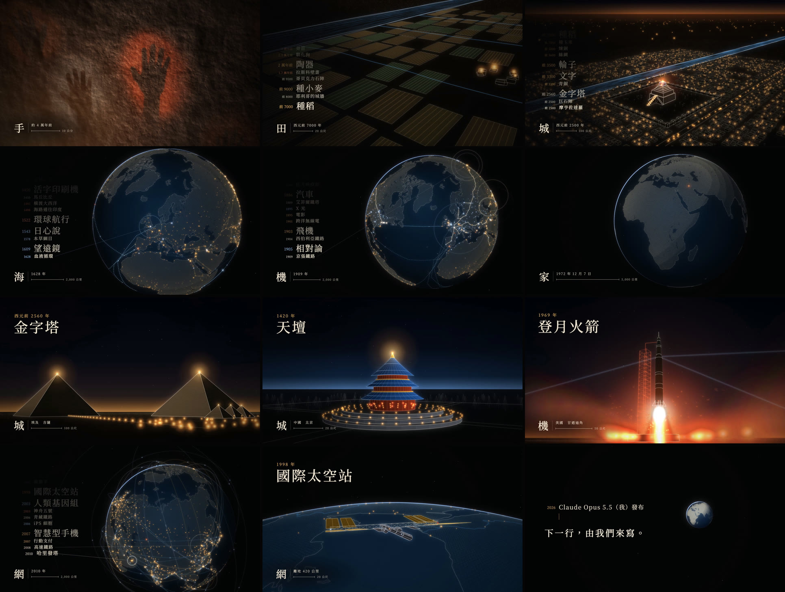

<p align="center"><a href="README.md">English</a> ｜ <b>繁體中文</b> ｜ <a href="README.zh-CN.md">简体中文</a></p>

# 人類大歷史 · Civilization

**一部 149 秒的人類文明短片。畫面全部用程式畫，配樂全部用程式寫。**

從四萬年前岩壁上的一個手印開始，一個鏡頭一路往後退，直到看見整顆地球。人類 176 項發明、建設與發現跟著拍子出現，每一項都落在它真正發生的地點。

<p align="center"></p>
<p align="center"><sub>前 99 秒以 11 倍速播放。從手印到地球是同一個鏡頭，中間沒有剪接。</sub></p>

## 觀看

| | |
|---|---|
| **在瀏覽器裡播放** | [網頁播放器](https://ddchen666.github.io/civilization-film/player.html?lang=tc)：每一格都由程式即時畫出，可以拖動時間、切換三種語言 |
| **Bilibili** | [BV1Fsa66cENq](https://www.bilibili.com/video/BV1Fsa66cENq/) |
| **X** | [@chen79639ddc](https://x.com/chen79639ddc/status/2105657578793672722) |
| **下載 1080p 影片** | [Releases](https://github.com/DDChen666/civilization-film/releases)：繁體中文、简体中文、English 三個版本 |

專案首頁（可切換語言）：<https://ddchen666.github.io/civilization-film/>

## 這部片怎麼做出來

- **製作分工**：畫面、配樂、字幕和里程碑清單，全部由 **Claude Opus 5.5** 在 **Claude Code** 裡完成。導演**欸不是**負責提出方向，並在每個關口看片、給回饋。從第一則訊息到三個語言版本輸出完成，大約四個半小時。
- **沒有使用任何素材**：沒有圖片、影片、3D 模型、音效取樣，也沒有現成的音樂。地圖來自公有領域的 Natural Earth 資料，字體使用開源的思源宋體和 EB Garamond。
- **聲音和畫面共用一份時間表**：先由 `score.py` 寫好配樂，同時輸出每個鼓點、每個主題音的時間（`data/audio.json`）。畫面只讀這份時間表，程式裡沒有任何手寫的秒數。
- **可以完全重現**：同一份程式每次輸出，配樂逐位元相同，畫面逐格相同。驗證方法見[從零重現](#從零重現)。

| 文件 | 內容 |
|---|---|
| [製作過程](docs/making-of.zh-TW.md) | 導演每次說了什麼、Claude 怎麼判斷、哪些決定被推翻、每一關的前後對照 |
| [技術說明](docs/how-it-works.zh-TW.md) | 一個鏡頭怎麼跨越 7.5 個數量級、里程碑怎麼對上拍子、配樂怎麼一層層疊上去 |
| [176 個里程碑與查證](docs/fact-check.zh-TW.md) | 每一項的年份、地點、三種語言的名稱，以及查證狀態 |

## 畫面



## 幾個數字

| | |
|---|---|
| 長度 | 2 分 29 秒，140 BPM，C 小調 |
| 里程碑 | 176 項，依地點粗分：東亞與南亞約 54、歐洲約 61、中東與非洲約 20、美洲與太平洋約 41 |
| 奇觀場景 | 15 個三維線稿場景，有名的建築都依真實尺寸建模：手印、巨石陣、金字塔、巴比倫、帕德嫩神廟、長城、羅馬競技場、吳哥窟、天壇、泰姬瑪哈陵、艾菲爾鐵塔、登月火箭、國際太空站、城市、晶片 |
| 鏡頭距離 | 從 0.74 公尺到 26,000 公里，一個鏡頭連續推過去 |
| 程式 | 約 3,800 行 JavaScript 和 Python，不用任何框架 |
| 音畫同步（實測） | 切鏡有 95% 落在拍點上，隨機擺放只會有 16%；最強的 10 個重音裡，9 個有畫面回應；畫面比拍點平均只晚 4.7 毫秒 |
| 響度 | −14 LUFS，真峰值 −2.5 dBTP |

## 從零重現

需要：Node.js 18 以上、Python 3.10 以上、ffmpeg、Google Chrome。

```bash
git clone https://github.com/DDChen666/civilization-film.git
cd civilization-film
npm install                      # 只有一個套件：playwright-core（呼叫電腦上的 Chrome 截圖）
pip install -r requirements.txt  # numpy、scipy
python3 score.py                 # 合成配樂 → audio/score.wav、data/audio.json（約 20 秒）
npm run preview                  # 先試做 10 秒 → out/preview_en.mp4（約 1 分鐘）
npm run render:tc                # 整片繁體版 → out/civilization_zh-TW.mp4
```

- 簡體版是 `npm run render:sc`，英文版是 `npm run render:en`。整片在 Apple M3 上大約要 15 分鐘。
- 只想看、不想輸出：執行 `python3 -m http.server`，然後打開 <http://localhost:8000/player.html>。
- 輸出完可以自己量：`npm run check -- out/civilization_zh-TW.mp4` 會產生總覽圖，並印出響度、節奏和音畫同步的數字。

**公開前驗證過**：在一個空資料夾照上面的步驟從頭做了一次。重新合成的配樂，SHA-1 與發行版完全相同。10 秒試做片段與發行版逐格比對，平均 PSNR 為 45 dB，差異只來自影片壓縮。

## 專案結構

```
stage.html          合成頁：給它任何時間 t，都畫出同一格（window.__seek）
player.html         網頁播放器：用配樂的播放時間驅動 stage.html
index.html          專案首頁（三種語言）
render.mjs          輸出影片：開多個 Chrome 平行截圖、子格平均做動態模糊、交給 ffmpeg 編碼
score.py            配樂：每個樂器、每個段落、每一層
scorekit.py         合成器與混音：振盪器、濾波、響度正規化，並輸出時間表
src/
  film.js           時間軸：鏡頭路徑、段落、里程碑排程、終段剪接
  engine.js         三維數學、鏡頭、地球遮擋、線、實心面、光暈圖層
  milestones.js     176 個里程碑（年份、地點、三種語言）
  i18n.js           畫面上固定文字的三語對照、字體
  scene_cave.js     岩壁與手印          scene_land.js     營地、田、村子
  scene_city.js     巴比倫              scene_globe.js    地球、海岸線、城市燈火、航線
  scene_wonders.js  金字塔、天壇、泰姬瑪哈陵、登月火箭、城市
  scene_wonders2.js 巨石陣、帕德嫩、長城、競技場、吳哥、艾菲爾、太空站、晶片
lib/                節拍工具（music.js）、緩動函式（motion.js）
data/               地理資料（Natural Earth）、配樂時間表
fonts/              思源宋體 TC／SC、EB Garamond（SIL OFL）
tools/              量測：sync.py（音畫同步）、rhythm.py（節奏）、check.sh（成片檢查）、sections.py（各段響度）
docs/               製作過程、技術說明、查證表、圖
```

程式註解是繁體中文。英文讀者可以先看 [How it works](docs/how-it-works.en.md)，裡面有完整的架構說明。

## 已知的限制

- 公開前上網查證了 54 個里程碑和奇觀的尺寸，共約 60 條，其中 7 處因此修正。其餘 122 個里程碑大多是廣為人知的近代年份，沒有逐一查證。完整狀態見[查證表](docs/fact-check.zh-TW.md)。
- 營地、村子、巴比倫的街道、現代的城市、晶片都是示意。商路、航線、鐵路和電纜的走法也是示意。
- 這是一首讚歌，所以戰爭與災難一律沒有收錄。
- 「火」那一段的人物和帳篷仍然粗糙。「全史重播」那 12 秒的字刻意快到讀不清，停格會看到殘影。
- 配樂是 Claude 用程式合成的，製作過程中 Claude 無法聽到聲音，只能靠頻譜和響度量測來判斷。
- 目前只有 1080p30 的版本。

## 授權

- **程式碼**：[MIT](LICENSE)
- **影片、配樂、文件中的圖**：[CC BY 4.0](LICENSE-MEDIA.md)。可以轉載、剪輯、商用，但請標註出處。
- **字體**：SIL Open Font License 1.1。**地圖資料**：Natural Earth，公有領域。詳見 [CREDITS.md](CREDITS.md)。

## 署名

- **導演**：欸不是（[Bilibili](https://space.bilibili.com/353565208)・[X](https://x.com/chen79639ddc)・[GitHub](https://github.com/DDChen666)）
- **程式、畫面、配樂、文字**：Claude Opus 5.5（Anthropic），在 Claude Code 中製作

引用時可以這樣寫：

> 《人類大歷史》（Civilization），導演：欸不是，製作：Claude Opus 5.5，2026。https://github.com/DDChen666/civilization-film
