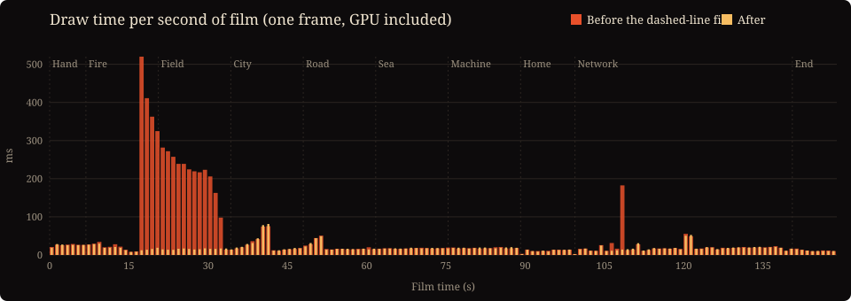
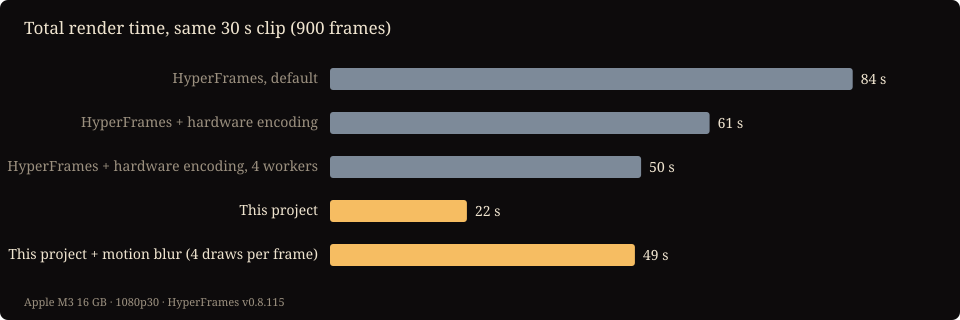

<p align="center"><b>English</b> ｜ <a href="fast-render.zh-TW.md">繁體中文</a> ｜ <a href="fast-render.zh-CN.md">简体中文</a></p>

# From 15 minutes to 1 minute 41 seconds

<sub>2026-10-04 · By 欸不是 · Implemented and written by Claude Opus 5.5 (Claude Code)</sub>

*Civilization* is a 149-second film drawn entirely in code. Rendering it used to take 15 and a half minutes. It now takes 1 minute 41 seconds, more than 9× faster, with no visible difference in the picture.

This post explains how. The point is not a single trick but a method: **measure first, find the real bottleneck, then change something.** There turned out to be two bottlenecks, and the second was hidden well enough that guessing would never have found it.

| | Before | After |
|---|---|---|
| Full film, 1080p30 (4,470 frames, 4 sub-frames each for motion blur) | 932 s | **101 s** |
| Full film, 4K60 (8,940 frames, 8 sub-frames each) | about 4 hours (estimated) | 20–30 minutes (estimated) |
| Against HeyGen's open-source HyperFrames (same 30 s, no motion blur) | — | 22 s vs 50 s |

Every number was measured on an Apple M3 with 16 GB of RAM. The code is in this repository, so you can rerun the tests yourself (see the end of this post).

---

## Background: how the film becomes a video

The picture is a web page (`stage.html`) that follows one rule: for any time t, it draws exactly the same frame (`window.__seek(t)`). The renderer, `render.mjs`, opens several Chrome instances. Each one takes a segment of the film and draws it frame by frame, and ffmpeg encodes the result.

For real motion blur, each frame is drawn 4 times while the virtual shutter is open, and the results are averaged. A 149-second film therefore takes 4,470 × 4 = 17,880 draws.

## Step 1: measure, don't guess

How long does one frame take to draw? Measured in the browser: **about 5 ms**. At that rate, 17,880 draws should take about 90 seconds. The full render took 932.

So most of the time was not spent drawing. It was spent getting each frame out of the browser. The old renderer took a 1920×1080 screenshot after every draw, compressed it to JPEG, passed it to Node through the browser's debugging protocol, and wrote it to ffmpeg. That works out to about 300 ms per screenshot, sixty times the cost of drawing the frame.

## Step 2: skip the screenshots and use the hardware encoder

Chrome's WebCodecs API lets a web page use the machine's video encoder directly. On a Mac, that is the hardware encoder (VideoToolbox). The new renderer does everything inside the page:

```js
for (let n = a; n < b; n++) {
  for (let j = 0; j < SUB; j++) {                 // motion blur: draw SUB times while the shutter is open
    window.__seek((n + offset(j)) / FPS);
    acc.globalAlpha = 1 / (j + 1);                // running mean: sample j weighs 1/(j+1)
    acc.drawImage(canvas, 0, 0);
  }
  encoder.encode(new VideoFrame(accCanvas, { timestamp }));   // hardware H.264
}
```

Every few megabytes, the encoded data goes back to Node and is written to disk. Each Chrome's segment starts on a keyframe, so the segments can be concatenated directly. ffmpeg only wraps the result and adds the audio, with no re-encoding.

**With a single Chrome, throughput went from 0.8 frames per second to 18.** The best number of Chrome instances also had to be measured (film seconds 60–90, 4 sub-frames per frame):

| Chrome instances | 1 | 2 | 3 | 4 | 6 |
|---|---|---|---|---|---|
| Frames per second | 34 | 47 | **49** | 46 | 38 |

More than three instances is slower, because they compete for the GPU and the hardware encoder. Three is now the default.

Correctness: all 4,470 frames are present. Compared frame by frame against the released video, the average PSNR is 44 dB. The difference comes from the two encoders compressing differently and is invisible side by side.

**But the full film still took 471 seconds**, only twice as fast. At 5 ms per draw it should have finished in about two minutes. Something else had to be slow.

## Step 3: the bottleneck was inside the picture

This time the draw cost was measured second by second, sampling a few frames from each second of the film.

There is a trap here. Canvas drawing commands are queued and sent to the GPU later, so timing only the JavaScript measures how long it took to *queue* the work, not to *draw* it. Reading back a single pixel after each draw (`ctx.getImageData(0, 0, 1, 1)`) forces the browser to wait for the GPU, and only then is the timing real.



From second 17 to 32 (the end of "Fire" through "Field"), a frame took 200–500 ms. Everywhere else it took 10–30 ms. Those 16 seconds alone accounted for more than three quarters of the film's total draw time. (The shorter spike at 108 seconds is the Seine in the Eiffel Tower shot, another dashed line running off screen.)

The JavaScript for that section took only 1–3 ms, so the cost was all on the GPU side. Next came elimination: replace one suspect drawing function at a time with a no-op, and measure again. Glows, ground points, tents, the rock texture and blur filters were all cleared. The culprit was **dashed lines**.

| Removed | 18 s | 25 s | 30 s |
|---|---|---|---|
| (nothing) | 427 ms | 226 ms | 207 ms |
| Dashes drawn as solid lines | **11 ms** | **10 ms** | **11 ms** |

The rivers are drawn as flowing dashed lines that run far past the horizon. Once projected onto the screen, they can be millions of pixels long. The browser does not skip the off-screen part first. It cuts the entire path into dashes, millions of them per frame.

**The fix**: before stroking a dashed line, clip the projected polyline to the screen (plus a margin), stroke each visible piece separately, and use `lineDashOffset` to add back the clipped length so the visible dashes land exactly where they did before.

The details had to be confirmed by experiment rather than from memory. Drawing pairs of lines in Chrome and comparing them pixel by pixel confirmed three things:

1. The offset must *add* the clipped length (subtracting shifts every dash).
2. When a path breaks into several subpaths, the dash pattern restarts for each one instead of continuing.
3. Length keeps accumulating normally around polyline corners.

Two more findings came out of this:

- **`lineDashOffset` does not reset itself.** The old code called only `setLineDash([])` after a dashed line, so the offset leaked into the next one. The railways, sea routes and the Great Wall's battlements in the film were all quietly using the offset left behind by the rivers. To keep the film unchanged, the new code preserves that behavior. New code should reset the offset explicitly.
- **At around a million pixels of path length, the browser's own arithmetic drifts.** The original dashes were already slightly off, and the clipped version is the precise one. Those river frames therefore can't match pixel for pixel (51–54 dB, invisible to the eye). Every other frame is above 78 dB, effectively identical.

After the fix, the summed draw time of 149 sample frames (one per second of film) fell from 7.0 to 2.8 seconds, and **the full render fell from 471 to 101 seconds**.

## Compared with HyperFrames

[HyperFrames](https://github.com/heygen-com/hyperframes) is HeyGen's open-source framework for writing video as web pages. It has 56,000 stars on GitHub and is built for agents. To find out whether this approach matters outside this one project, a fair comparison was run on the same footage:

- The same drawing code: 30 seconds of the film starting at 1:39, 1080p30, 900 frames.
- HyperFrames v0.8.115, with `__seek(t)` wrapped in the timeline interface it expects.
- No motion blur on either side. HyperFrames was tested with its default settings and with its fastest settings.



| Setup | Total time |
|---|---|
| HyperFrames, default (auto-selects 1 worker) | 84 s |
| HyperFrames with hardware encoding (`--gpu`) | 61 s |
| HyperFrames with hardware encoding and 4 workers (fastest) | 50 s |
| This project | **22 s** |
| This project with motion blur (4 draws per frame) | 49 s |

In this scenario that is about 2.3× faster. Even with motion blur, which takes 4 times the drawing work, this project is about as fast as HyperFrames without it.

In fairness, HyperFrames has real advantages:

- **It handles HTML content** such as text, interfaces and video clips. This project's fast path only works with a canvas; with HTML content it falls back to screenshots and is about as fast as HyperFrames, or slower.
- **It is getting faster.** Recent versions added a screenshot-free capture method on macOS (drawElementImage), used when it runs with a single worker, and the gap is narrowing.
- **It is a maintained, complete product.** This is the renderer for one film.

So the conclusion is not "HyperFrames is slow". It is this: **if everything is drawn on a canvas, hardware encoding is worth it; for HTML-based videos, use HyperFrames.**

Note: HyperFrames sends anonymous usage telemetry (machine specs and usage counts) by default. Turn it off with `hyperframes telemetry disable` or the environment variable `DO_NOT_TRACK=1`.

## Lessons you can take with you

1. **When something is slow, measure before guessing.** Neither bottleneck here (screenshots, dashed lines) was where intuition pointed.
2. **Measure GPU time, not just JavaScript time.** Read back one pixel to force a sync, then time it.
3. **Once you've found the slow section, eliminate suspects one at a time.**
4. **Canvas-only animation doesn't need screenshots.** Encoding with WebCodecs removes the largest fixed cost.
5. **Things off screen still cost time**, especially effects the browser processes along a whole path, such as dashes, shadows and blur.
6. **Prove every "should be identical" with a frame-by-frame comparison.** That is how the leaked offset and the precision drift were found.

## Limitations

- Tested only on an Apple M3 with 16 GB. Other machines may have different hardware encoders and a different best number of Chrome instances.
- 4K60 was measured on only 3 seconds of footage (7.7 frames per second). The full-film time is an estimate.
- Hardware-encoded files are about 10% larger than x264 at similar quality.
- Google Chrome must be installed.

## Reproduce it

```bash
git clone https://github.com/DDChen666/civilization-film.git && cd civilization-film
npm install && pip install -r requirements.txt
python3 score.py           # synthesize the score
npm run render:en          # the full film (the fast path is used automatically)
node render.mjs video --engine shot --html "stage.html?lang=en" --audio audio/score.wav --out out/old.mp4   # the old screenshot path, for comparison
```

Relevant code: [`render.mjs`](../render.mjs) (`videoFast`, `encodeRange`) and [`src/engine.js`](../src/engine.js) (`dashLine`).
