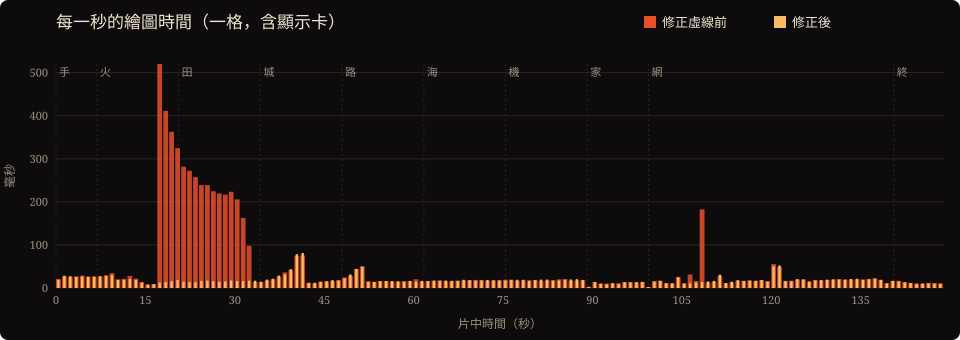
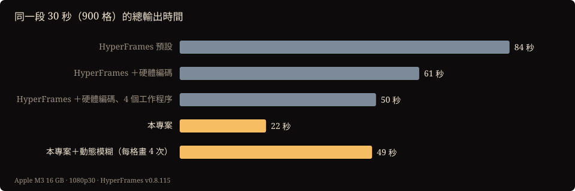

<p align="center"><a href="fast-render.en.md">English</a> ｜ <b>繁體中文</b> ｜ <a href="fast-render.zh-CN.md">简体中文</a></p>

# 把影片輸出從 15 分鐘縮到 1 分 41 秒

<sub>2026-10-04　作者：欸不是　實作與撰寫：Claude Opus 5.5（Claude Code）</sub>

《人類大歷史》是一部 149 秒、全部用程式畫出來的短片。原本輸出一次要 15 分半，現在只要 1 分 41 秒，快了 9 倍多，畫面肉眼看不出差別。

這篇文章記錄怎麼做到的。重點不在某個技巧，而在方法：**先量，找到真正的瓶頸，再動手。** 這次一共找到兩個瓶頸，第二個藏得很深，猜是猜不到的。

| | 原本 | 現在 |
|---|---|---|
| 整片 1080p30（4470 格，每格 4 個子格做動態模糊） | 932 秒 | **101 秒** |
| 整片 4K60（8940 格，每格 8 個子格） | 估計約 4 小時 | 估計 20–30 分鐘 |
| 跟 HeyGen 開源的 HyperFrames 比（同一段 30 秒、不做動態模糊） | — | 22 秒 對 50 秒 |

所有數字都在 Apple M3（16 GB）上實測。測試的程式就在這個專案裡，可以自己重跑（見文末）。

---

## 背景：這部片怎麼變成影片

這部片的畫面是一個網頁（`stage.html`）。它只遵守一條規則：給它任何時間 t，它就畫出完全相同的一格（`window.__seek(t)`）。輸出程式 `render.mjs` 開好幾個 Chrome，各自負責一段，一格一格地畫，最後交給 ffmpeg 編成影片。

為了做出真正的動態模糊，每一格會在「快門開著」的那段時間裡畫 4 次，再取平均。所以 149 秒的片要畫 4470 × 4 = 17,880 次。

## 第一步：先量，不要猜

一格畫面要畫多久？在瀏覽器裡實測，**大約 5 毫秒**。照這個速度，畫 17,880 次只要約 90 秒，但整片輸出花了 932 秒。

所以絕大部分的時間不是花在「畫」，而是花在「把每一格搬出來」：舊做法每畫一次就截一張 1920×1080 的圖，壓成 JPEG，經過瀏覽器的除錯介面傳給 Node，再寫給 ffmpeg。換算下來，每張截圖約 300 毫秒，是畫圖本身的六十倍。

## 第二步：不截圖，直接交給硬體編碼器

Chrome 有一套叫 WebCodecs 的功能，網頁可以直接使用電腦的影片編碼器。Mac 上背後就是硬體編碼器（VideoToolbox）。新的做法完全在頁面裡完成：

```js
for (let n = a; n < b; n++) {
  for (let j = 0; j < SUB; j++) {                 // 動態模糊：快門期間畫 SUB 次
    window.__seek((n + offset(j)) / FPS);
    acc.globalAlpha = 1 / (j + 1);                // 連續平均：第 j 張佔 1/(j+1)
    acc.drawImage(canvas, 0, 0);
  }
  encoder.encode(new VideoFrame(accCanvas, { timestamp }));   // 硬體 H.264
}
```

編碼後的資料每累積幾 MB 就交回 Node，寫進檔案。每個 Chrome 負責的一段都從關鍵格開始，所以最後可以直接首尾相接，ffmpeg 只負責封裝和混入配樂，不用重新編碼。

**只開一個 Chrome，速度就從每秒 0.8 格提升到每秒 18 格。** 開幾個 Chrome 最快，也要實測（片中 60–90 秒，每格 4 個子格）：

| Chrome 數 | 1 | 2 | 3 | 4 | 6 |
|---|---|---|---|---|---|
| 每秒格數 | 34 | 47 | **49** | 46 | 38 |

開超過 3 個反而變慢，因為顯示卡和硬體編碼器被搶著用。預設就設成 3 個。

畫面正確性：4470 格一格不差，跟原本的發行版逐格比對，平均 PSNR 44 dB（差異來自兩種編碼器的壓縮方式不同，並排看不出來）。

**但整片仍然要 471 秒**，只快了一倍。照每格 5 毫秒推算，應該兩分鐘就跑完。一定還有什麼地方特別慢。

## 第三步：瓶頸藏在畫面裡

這次逐秒量，片子的每一秒取幾格，計算每格要畫多久。

這裡有一個陷阱：瀏覽器的畫布繪圖是先排隊，晚一點才交給顯示卡執行。如果只量 JavaScript 的執行時間，看到的是「排隊」花了多久，而不是「畫」花了多久。要在每次繪圖之後讀回一個像素（`ctx.getImageData(0, 0, 1, 1)`），強迫瀏覽器等顯示卡畫完，量到的才是真正的時間。



第 17 到 32 秒（「火」的後半到「田」），一格要 200–500 毫秒，其他段落只要 10–30 毫秒。光這 16 秒，就占了整片繪圖時間的四分之三以上。（第 108 秒那根較短的高峰，是艾菲爾鐵塔鏡頭裡的塞納河，同樣是延伸到畫面外的虛線。）

這一段的 JavaScript 只要 1–3 毫秒，所以成本全在顯示卡那一側。接著用消去法：把可疑的繪圖函式一個一個換成什麼都不做，再量一次。光暈、地面的點、帳篷、岩壁貼圖、模糊濾鏡都不是原因。最後找到兇手：**虛線**。

| 拿掉什麼 | 18 秒 | 25 秒 | 30 秒 |
|---|---|---|---|
| （原樣） | 427 毫秒 | 226 毫秒 | 207 毫秒 |
| 虛線改成實線 | **11 毫秒** | **10 毫秒** | **11 毫秒** |

河流用的是會流動的虛線，而且一路延伸到地平線外很遠的地方，投影到畫面上可能長達幾百萬像素。瀏覽器不會先跳過畫面外的部分，而是把整條路徑都切成一段一段的虛線，一格就要切幾百萬段。

**修法**：畫虛線之前，先把投影後的折線裁到畫面範圍（外加一點邊）裡，再一段一段描，然後用 `lineDashOffset` 補回被裁掉的長度，讓看得到的虛線位置跟原本一樣。

這裡的細節要用實驗確認，不能憑印象。在 Chrome 裡畫兩條線逐像素比對，確認了三件事：

1. 偏移量要「加上」裁掉的長度（用減的話，整條虛線會錯開）。
2. 一條路徑斷開成好幾段時，每一段的虛線重新起算，不會接續。
3. 折線轉角處的長度照常累計。

另外還發現兩件事：

- **`lineDashOffset` 不會自己歸零。** 原本的程式畫完虛線只呼叫 `setLineDash([])`，偏移量會殘留給下一條虛線。結果片中的鐵路、航線、長城的垛口，其實都沿用了河流留下來的偏移量。為了讓成片不變，新的程式照樣沿用。新寫的程式要記得自己歸零。
- **線長到約一百萬像素時，瀏覽器本身的計算就有誤差。** 原本畫出來的虛線位置已經有點偏，裁過之後反而是精確的。所以河流那幾格沒辦法跟原本逐像素相同（51–54 dB，肉眼看不出來）；其他畫面都在 78 dB 以上，等於完全一樣。

修完之後，每一秒取一格、149 格的繪圖時間加總，從 7.0 秒降到 2.8 秒，**整片輸出從 471 秒降到 101 秒**。

## 跟 HyperFrames 比較

[HyperFrames](https://github.com/heygen-com/hyperframes) 是 HeyGen 開源的「用網頁寫影片」框架，GitHub 上有 5.6 萬顆星，也是給 agent 用的。為了知道這次的做法放到外面有沒有意義，用同一段畫面做了公平比較：

- 同一份繪圖程式碼，文明片 1:39 起的 30 秒，1080p30，共 900 格。
- 用 HyperFrames v0.8.115 的轉接方式，把 `__seek(t)` 包成它認得的時間軸。
- 兩邊都不做動態模糊；HyperFrames 測了預設設定和它最快的設定。



| 設定 | 總時間 |
|---|---|
| HyperFrames 預設（自動選 1 個工作程序） | 84 秒 |
| HyperFrames 加硬體編碼（`--gpu`） | 61 秒 |
| HyperFrames 加硬體編碼，4 個工作程序（最快） | 50 秒 |
| 本專案 | **22 秒** |
| 本專案，加上動態模糊（每格畫 4 次） | 49 秒 |

在這個情境下快約 2.3 倍；做了 4 倍運算量的動態模糊，速度也跟 HyperFrames 不做模糊時差不多。

公平起見，也要說清楚它的優勢：

- **HyperFrames 能處理網頁元素**（文字、介面、影片片段）。本專案的快速做法只認畫布，遇到網頁元素會退回截圖，速度跟它差不多甚至更慢。
- **它正在變快。** 新版在 Mac 上加入了一種不截圖的擷取方式（drawElementImage），只開一個工作程序時就會用上，差距正在縮小。
- **它是持續維護的完整產品**；本專案只是一部片的輸出程式。

所以結論不是「它比較慢」，而是：**如果畫面全部畫在畫布上，硬體編碼這條路值得走；如果是網頁排版的片，用 HyperFrames。**

附註：HyperFrames 預設會送出匿名使用統計（電腦規格與使用次數），可以用 `hyperframes telemetry disable` 或環境變數 `DO_NOT_TRACK=1` 關閉。

## 能帶走的教訓

1. **慢的時候先量，不要猜。** 這次的兩個瓶頸（截圖、虛線）都不在直覺會懷疑的地方。
2. **量顯示卡的時間，不能只量 JavaScript。** 畫完讀回一個像素，強迫同步，再計時。
3. **找到慢的段落後用消去法**，一次關掉一個繪圖動作。
4. **純畫布的動畫不需要截圖。** WebCodecs 直接編碼，省掉最大的固定成本。
5. **畫面外的東西也有成本。** 尤其是虛線、陰影、模糊這類瀏覽器會整條處理的效果。
6. **每一個「應該一樣」都要逐格比對證明。** 這次靠逐格比對，才發現殘留偏移量和精度誤差這兩件事。

## 限制

- 只在 Apple M3（16 GB）上測過。其他電腦的硬體編碼器、最佳的 Chrome 數量可能不同。
- 4K60 只實測了 3 秒（每秒 7.7 格），整片時間是推估的。
- 硬體編碼的檔案比 x264 大一成左右，畫質相當。
- 需要電腦上裝有 Google Chrome。

## 自己重現

```bash
git clone https://github.com/DDChen666/civilization-film.git && cd civilization-film
npm install && pip install -r requirements.txt
python3 score.py           # 合成配樂
npm run render:tc          # 整片（快速做法會自動啟用）
node render.mjs video --engine shot --html "stage.html?lang=tc" --audio audio/score.wav --out out/old.mp4   # 用舊的截圖做法對照
```

相關程式：[`render.mjs`](../render.mjs)（`videoFast`、`encodeRange`）、[`src/engine.js`](../src/engine.js)（`dashLine`）。
