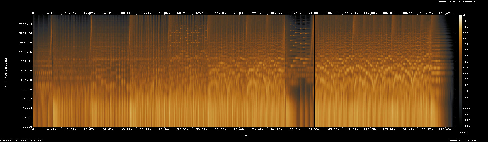
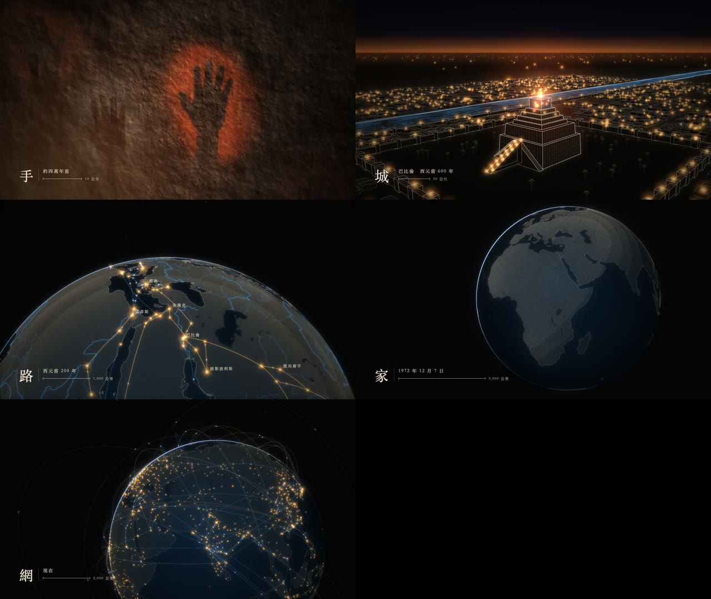
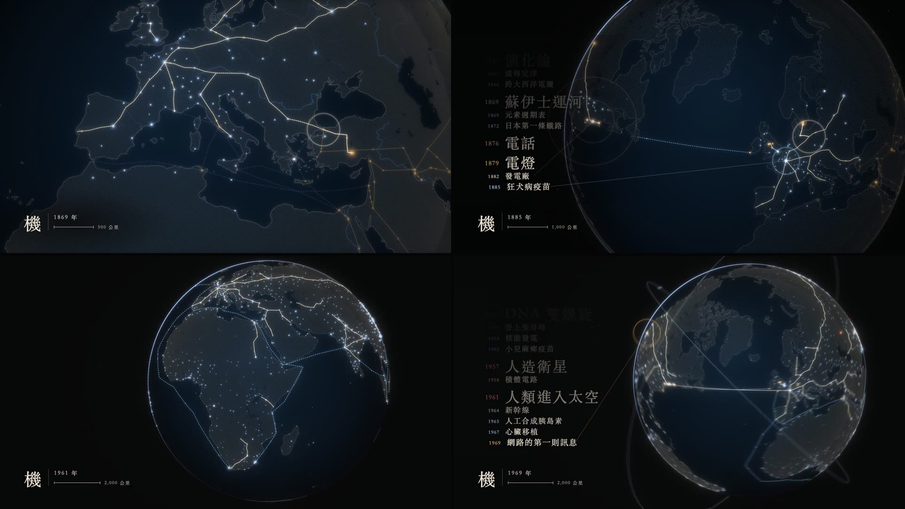

<a href="making-of.en.md">English</a> ｜ <a href="making-of.zh-TW.md">繁體中文</a> ｜ <b>简体中文</b>

# 制作过程

这份文档写给想知道“一个人加上 Claude Code，怎么在一个傍晚做出这部片”的人。

文中引用的导演的话都是原话（原文为繁体中文）。Claude 的判断、被推翻的决定、每一关的测量数字，则按照制作当时的记录整理。

## 一页看完

2026 年 10 月 1 日，台湾时间：

| 时间 | 发生的事 |
|---|---|
| 17:19 | 导演提出需求，附上一首参考配乐和一部同主题的参考片 |
| 17:35 | 导演补充两点：这部片要公开发布，所以配乐要自己做；画法用 Claude 擅长的形式 |
| 18:02 | **关口一**：五张关键帧和配乐草稿，做成网页给导演看 |
| 18:15 | 导演：“我看了，非常让人振奋!” |
| 18:50 | **关口二 v1**：先做最难的 34 秒（1:15–1:49） |
| 18:56 | 导演：“密度有点太低”，并要求东方与西方并重 |
| 19:12 | **关口二 v2**：加入里程碑系统 |
| 19:16 | 导演：“好！！！” |
| 20:35 | **整片 v1**，2 分 29 秒 |
| 20:46 | 导演：“我看了非常感动”，要求简体版和英文版，并指定最后一个里程碑 |
| 21:17–21:49 | 先核实约 60 项史实、把字体换成开源字体，再输出繁体、简体、英文三个版本 |

前后大约四个半小时。输出视频、测量音画同步、检查成片的工具，是在之前几部练习片里做好的，这次直接拿来用。

---

## 0. 起点：导演给了什么

第一条消息：

> 我希望你建立一部极其振奋、动效出众，而且比这世界上绝大多数最顶级的动画创作者的创作都更惊人、更震撼的一部文明影片。我方才传给你的 Bilibili 链接，其中一个影片就是类似的主题。我期望与他有做出差异化，而且比他做的更惊人、更让人震撼，所以我想跟你讨论一下，你认为要做什么样的变化？

十六分钟后的第二条：

> 这支片会公开发布，所以音乐的部分，我也期望是你可以自己制作……我提供的那个配乐，主要是想要传递我渴望一种强烈、澎湃、层层堆砌而上的一种感受。然后是绘制方面，我个人会认为，你应该可以使用你更擅长的艺术形式。

导演提供了两份参考：

- **一首预告片配乐**（Immediate Music 的作品）：只拿来分析它“层层堆叠”的结构，测出 141 BPM、每八小节加一层。**这首曲子没有用进片子里，也不包含在这个项目中。**
- **Bilibili 上一部同主题的作品**：拿来拆解它的语法，再刻意做出差异。

Claude 没有直接开始写代码，而是先当顾问：分析参考配乐、拆解参考片、提出差异化的方向、列出风险，然后交出一个定案和理由。这部片的整个合作都是这个模式：**Claude 下判断，导演看片，告诉 Claude 哪里不对。**

## 1. 构想：一个镜头，从手印到地球

构想定案时的一句话：

> 同一个世界、一个一直往后退的镜头：从岩壁上的一个手印退到整颗地球。人类的世界一圈一圈变大；画过的东西都留着。

**画法**（Claude 的选择）：

- 暗底上发光的细线与光点，而且是真的三维。镜头后退时，近的东西动得快、远的动得慢；地面退得够远时，会自己弯成地球，因为远方的地理就放在真实半径的球面上。
- 整部片只用三种东西：线、会挡住后面的实心面、光点。
- 颜色跟着历史一个一个解锁：骨白与赭红（手、火）→ 金（灯火）→ 青金石蓝（水、海）→ 冰蓝与白（电、网）。
- 海岸线、河流、城市位置都用真实数据（Natural Earth）。

**结构**：140 BPM，每八小节一段，每段用一个字命名，配乐也每段加一层。

| 段 | 时间 | 画面 | 镜头距离 |
|---|---|---|---|
| 手 | 0:00 | 岩壁，颜料喷出手印 | 0.7 米 |
| 火 | 0:07 | 营火、围坐的人、帐篷 | 几米 |
| 田 | 0:21 | 田、水渠、村子 | 几百米 |
| 城 | 0:34 | 巴比伦：塔庙一拍长一层 | 几公里 |
| 路 | 0:48 | 商路把旧大陆的城市连起来 | 一千公里 |
| 海 | 1:02 | 郑和、达伽马、哥伦布、麦哲伦的航线 | 一万公里 |
| 机 | 1:15 | 铁路、电缆、电灯缠住地球 | 整颗地球 |
| 家 | 1:29 | 整颗地球，音乐全部拿掉 | 29,400 公里 |
| 网 | 1:39 | 地球亮起来；奇观连击；全史重播 | 来回 |
| 终 | 2:21 | 地球退成一个点；一行字 | — |

当时列出的最大风险是：**前 82 秒不剪辑，只靠一个往后退的镜头，撑不撑得住节奏？** 所以关口二决定先做最难的一段。

## 2. 配乐：自己写，而且先写

配乐在画面之前就写好了。理由是画面要对齐声音的时间网格，不能等画面做完再配乐。

`score.py` 只用数学合成声音，没有任何采样：

- 140 BPM，C 小调，四个和弦 Cm–Ab–Eb–Bb 从头到尾不变。
- 每八小节加一层：大鼓（3+3+2 的节奏）和框鼓 → 低音弦的短弓 → 整套鼓、低音铜管、和弦重音 → 高音弦的快速音型、钟声奏主题 → 合唱与弦乐长音 → 铜管全力奏主题。
- 四次真正的静默，每次之后接一记重击。终段改从 Eb 开始，由暗转亮；最后八小节再升一个全音。
- 输出 `audio/score.wav` 的同时，也输出 `data/audio.json`，记下每一拍、每一个鼓点、每一个主题音、每一段的时间。**画面只读这份文件。**

Claude 听不到声音，只能用测量来判断：逐段响度从“火”的 −21.7 LUFS 一路升到“网”的 −14.0，“家”那段故意降回 −22.2。

导演的评语：“配乐是非常棒的。”

## 3. 关口一：五张关键帧

先不做动画，只画五张关键帧（手、城、路、家、网），连同配乐草稿做成一个网页给导演看。

导演：“我看了，非常让人振奋!”

## 4. 关口二：先做最难的 34 秒，然后被推翻

关口二选了 1:15–1:49 这一段：机 → 静默 → 家 → 终段第一击。整部片最大的情绪转折都在这里。

制作途中，导演问了一句：

> 这部影片会展现出人类璀璨的文明与科技吗？

Claude 的判断是不够。原本的版本偏“地图与灯光”，具体的成就只有巴比伦。于是把终段改成“奇观与科技的连击”，每一个奇观都按真实尺寸做成三维线稿。

v1 交出去之后，导演的反馈：

> 配乐是非常棒的。但要我说的话，就是密度有点太低。我指的是，这整部影片几乎没有什么大发明、大建设、大事件，可以说是几乎没有任何文字，这点不太好……我以为会随着节拍，每一条路的开通，对应着一个又一个的发明、科技进展，或者是建设历史节点……因为人类的历史就是不停加速的旅程。

> 我会希望不止局限于西方，整个世界，尤其东方与西方的文明，都是非常有价值、很重要。这是献给人类历史、人类文明、人类交通、人类科技的赞歌。

**被推翻的决定。** 为了和参考片做出差异，Claude 在构想时故意把“年份加名词的清单”列为不做的事。导演的反馈说明这个判断错了：导演要的正是有名字、有年份、一件接一件、越来越密的清单。Claude 整个改掉：

- **里程碑系统**：每一行数据包含年份、名称、经纬度、是否放大字、种类。左边一张往上滚的清单，每一拍、半拍或四分之一拍进一行。最新的一行有一条线连到地球上的那个地点，那里放出一圈光，之后留下一盏灯。
- **加速的感觉用密度表现**：节拍不变，每一拍的里程碑越来越多。手 1 项 → 火 4 → 田 8 → 城 16 → 路 29 → 海 27 → 机 51 → 网 40，最后再把全部 176 项重播一次。
- **镜头跟着历史走**：镜头看向“最近几拍的里程碑的重心”，地球会自己转过去，面对正在发生事情的地方。
- **东西方并重**：清单和奇观都加入东亚、南亚、伊斯兰世界、非洲和美洲，例如造纸、活字、指南针、火药、都江堰、大运河、地动仪、郑和、零与十进制、代数、智慧宫、吴哥、马丘比丘、廷巴克图、大津巴布韦、波利尼西亚的航海。
- **差异化重新定义**：每一件事都钉在它发生的地点、东西方并重、做过的事留在地球上变成灯、建筑是真三维。

同一时刻的对照，左为 v1、右为 v2（画面为繁体版）。

| 测量（`tools/sync.py`） | v1 | v2 |
|---|---|---|
| 切镜落在节拍上 | 100% | 100% |
| “机”每拍的画面事件 | 0.50 | 0.62 |
| “网”每拍的画面事件 | 0.42 | 0.54 |

导演：“好！！！”

## 5. 整片

第一部（0:00–1:29）是一个镜头，中间不剪辑。镜头在世界坐标里走一条路，距离从 0.74 米推到 26,000 公里。每一拍镜头往后踢一下，拍与拍之间再慢慢退。画面随距离换手：营地和田 → 巴比伦 → 地球，换手的地方用重击时的闪白盖住，或让两个画面叠在一起淡入淡出。

终段（1:39–2:20）每一拍剪一刀：十五个奇观按年代走一遍 → 1983–2023 年的三十二件事，半拍一件 → 交通四个镜头（丝绸之路、大航海、铁路、航线与网络）→ 升一个调，176 项里程碑全部重播 → 奇观回顾连击 → 最后一击。

交给导演之前，Claude 从成片抽帧自我审查了两轮。修掉的问题举例：

| 看到的问题 | 修法 |
|---|---|
| 10 公里和 300–2,000 公里这两个尺度画面很空，镜头飘到空地上 | 加入城外的水渠与村落、两河流域的聚落与道路；镜头目标在原点多停留一段时间 |
| “火”那一段每拍只有 0.06 个画面事件 | 营火在大鼓点上点燃，田和房子落在半拍上，镜头踢得更明显。提升到 0.28 |
| 长城整座消失 | 原本只要有一个点投影失败，就整层放弃。改成只画看得见的点 |
| 国际空间站不见了 | 镜头的近平面跟着目标距离变远，空间站被切掉。改用另一个近距离镜头来画 |
| 远处的城市小于一像素，整座消失 | 光点最小保留 2.2 像素 |
| 前 34 秒的配乐只有低频 | 加入框鼓、提高中频层，并且逐段调整音量 |

导演：“我看了非常感动。如果这部片你认为已经没问题了，请渲染简体中文版跟英文版本。”

## 6. 公开前：核实、开源字体、三种语言

Claude 当时的判断是**还不算没问题**，有两件事要先做：

1. **史实**：里程碑的年份当时全凭记忆。于是上网核实了约 60 条（54 个里程碑加上奇观的尺寸），修正 7 处：

| 原本 | 改成 | 依据 |
|---|---|---|
| 驯化狗　约 1.5 万年前 | 约 2.3 万年前（西伯利亚） | 年代仍有争议 |
| 驯化马　前 3500 | 前 2200 | 早期的波泰遗址证据有争议，现在的共识约是前 2200 |
| 铁器　前 1200 | 改称“铁器时代” | 炼铁本身更早 |
| 巨石阵　前 3000 | 前 2500，石圈直径 33 改成 30 米 | 石圈约建于前 2600–2400 |
| 火药　850 | 808 | 目前最早的文字记载 |
| 廷巴克图的学院 | 廷巴克图大清真寺 | 1327 年建的是清真寺 |
| 西伯利亚铁路　1916 | 1904 | 1904 年通车 |

2. **字体**：原本用的是系统自带字体，不能随作品分发。改成开源的思源宋体（繁、简）和 EB Garamond。

**三种语言**：用网址参数 `?lang=tc|sc|en` 切换。简体版不是机器转码，而是改用中国大陆的译名和用语，例如互联网、芯片、帕特农神庙、泰姬陵、公元前。英文版把每段的那个字换成一个词：HAND、FIRE、FIELD、CITY、ROAD、SEA、MACHINE、HOME、NETWORK。

**最后一个里程碑**。导演在这时补了一句：

> 影片的最后　我希望最后的里程碑是：“Claude Opus 5.5 （我）发布”　你本身的出现也是一个里程碑。

它成为清单的最后一行，也是全史重播的最后一件。片子结尾，它就在闪烁的光标正上方，下面是一行字：

> 下一行，由我们来写。

## 7. 合作方式：哪些做法有用

1. **先当顾问，再动手。** 先理解需求、拆解参考、提出一个定案和理由、列出风险，然后才写代码。
2. **用关口推进**：关键帧 → 最难的一段 → 整片。每一关都让导演亲眼看到成果（网页、视频），而不是读一段描述。
3. **导演给感受，Claude 转成结构。** “强烈、澎湃、层层堆砌而上”变成“每八小节加一层”；“人类的历史就是不停加速的旅程”变成“节拍不变，每拍的里程碑越来越密”。
4. **Claude 交定案，不丢选项。** 导演不必在 A、B、C 之间选，只要说哪里不对。
5. **测量取代感觉。** Claude 看不到动态、听不到声音，测量工具就是它的眼睛和耳朵：`sync.py` 测音画同步，`rhythm.py` 测节奏，`check.sh` 从成片抽帧。每个数字都从**输出的视频**测，不是从浏览器截图。
6. **被推翻时就彻底改。** “密度太低”这句反馈，让整部片从地图与灯光，变成以里程碑驱动。
7. **诚实。** 哪些没核实、哪些是示意、Claude 无法确认什么，都写进文档。

## 8. 工具

- **Claude Opus 5.5**，在 **Claude Code** 里运行
- **画面**：纯 Canvas 2D，加上自己写的三维投影（`src/engine.js`），没有用 WebGL 或任何框架
- **输出**：Node.js + playwright-core 驱动 Google Chrome 截图，ffmpeg 编码
- **配乐**：Python + numpy + scipy
- **地图**：Natural Earth（公有领域）

已知的限制见 [README](../README.zh-CN.md#已知的限制)。
